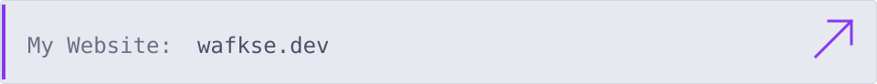
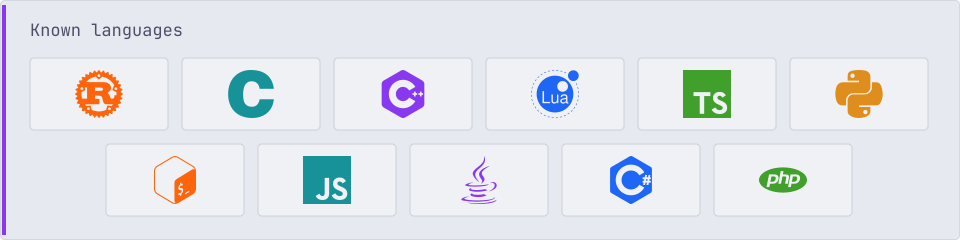

  <a href="https://wafkse.dev">
    <picture>
      <source media="(prefers-color-scheme: dark)" srcset="./assets/website-mocha.svg">
      
    </picture>
  </a>

<picture>
  <source media="(prefers-color-scheme: dark)" srcset="./assets/rhythm-mocha.svg">
  
</picture>

<picture>
  <source media="(prefers-color-scheme: dark)" srcset="./assets/language-mocha.svg">
  
</picture>

