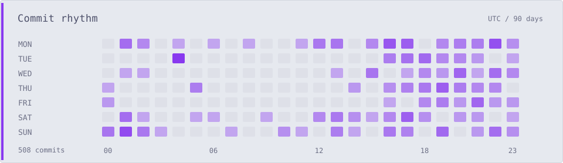
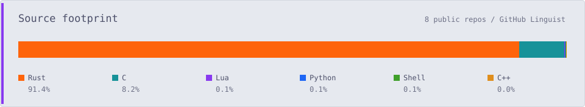

<picture>
  <source media="(prefers-color-scheme: dark)" srcset="./assets/rhythm-mocha.svg">
  
</picture>

<picture>
  <source media="(prefers-color-scheme: dark)" srcset="./assets/source-mocha.svg">
  
</picture>

  

