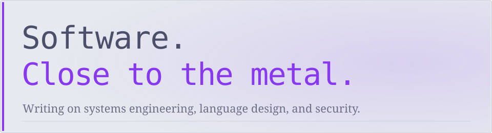

<picture>
  <source media="(prefers-color-scheme: dark)" srcset="./assets/editorial-dark.svg">
  
</picture>

  <a href="https://wafkse.dev">Website</a> ·
  <a href="https://wafkse.dev/blog/">Articles</a> ·
  <a href="https://wafkse.dev/about/">About</a> ·
  <a href="https://wafkse.dev/atom.xml">Atom</a>

  
Colophon

  Built from TOML and MiniJinja using [Mirage](https://github.com/wafkse/mirage). [Just](./Justfile) orchestrates the local build; [Actions](./.github/workflows/profile.yml) keeps the latest writing synchronized. No external profile-card services.

